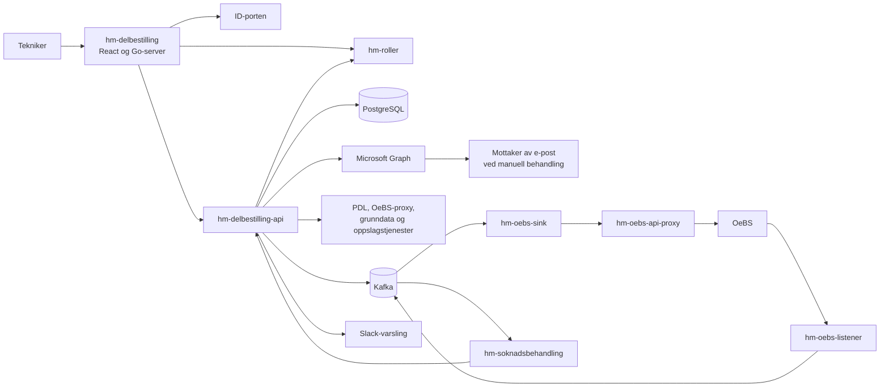
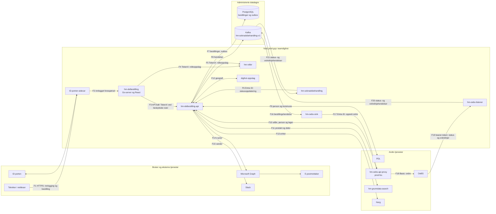
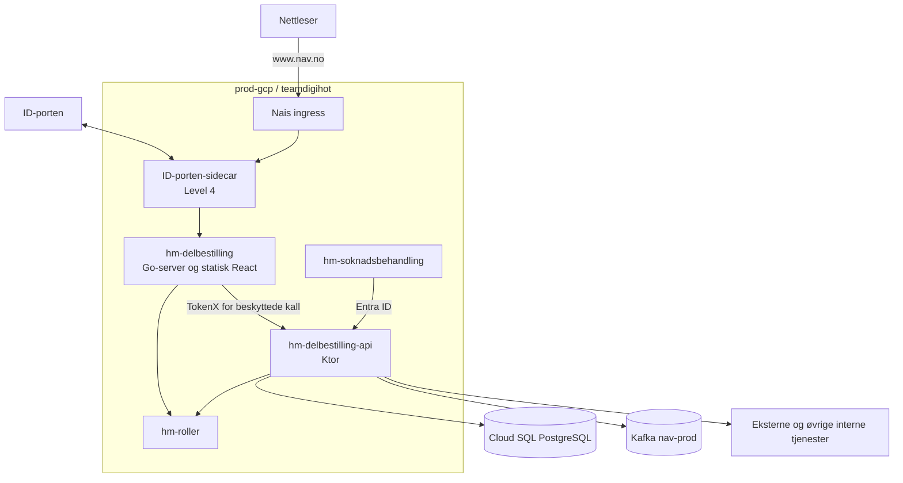
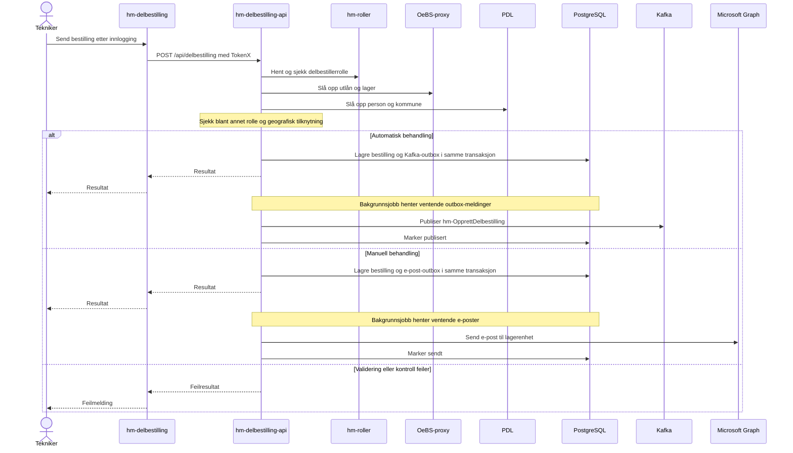
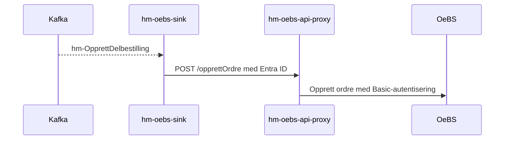
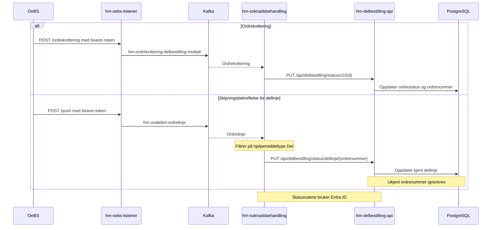

# Arkitektur og dataflyt

## Systemkontekst

## Dataflyt og tillitsgrenser

`/public/` på Go-serveren videresendes til API-et uten `IDPTarget`; API-ets
produktoppslag er ikke lagt under autentiseringsblokkene. De øvrige brukerrutene
bruker TokenX og sjekker delbestillerrolle. Statusrutene bruker Entra ID.
Nais-konfigurasjonen begrenser også hvilke applikasjoner som kan kalle API-et.

## Produksjonsoppsett

Produksjonskonfigurasjonen for frontend angir utgående tilgang til API-et,
`hm-roller` og Nav-dekoratøren. API-konfigurasjonen angir inngående tilgang fra
frontend og `hm-soknadsbehandling`. Se Nais-manifestene for fullstendige regler;
en tillatt nettverksforbindelse er ikke i seg selv autorisasjon.

## Innsending av bestilling

Diagrammet forenkler rekkefølgen på oppslag og kontroller. Bakgrunnsjobbene kjører
uavhengig av HTTP-svaret, så publisering eller sending kan skje før eller etter at
svaret er mottatt. Outbox-jobbene forsøker på nytt ved feil. Hvis publisering eller sending lykkes,
men markering i databasen feiler, kan meldingen eller e-posten sendes på nytt.
Vellykket innsending er ikke det samme som bekreftet opprettelse i OeBS.

Videreføring av den automatiske bestillingen:

## Status og skipningsbekreftelse

Listeneren publiserer hendelsene til Kafka. `hm-soknadsbehandling` konsumerer dem
og oppdaterer API-et.

Listeneren publiserer uvaliderte ordrelinjer for mottakende system DIGIHOT;
`hm-soknadsbehandling` filtrerer på `hjelpemiddeltype == "Del"`. API-et
ignorerer ordrelinjer der ordrenummeret ikke tilhører en kjent delbestilling.

